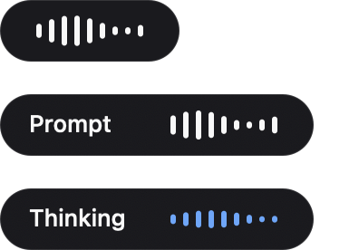
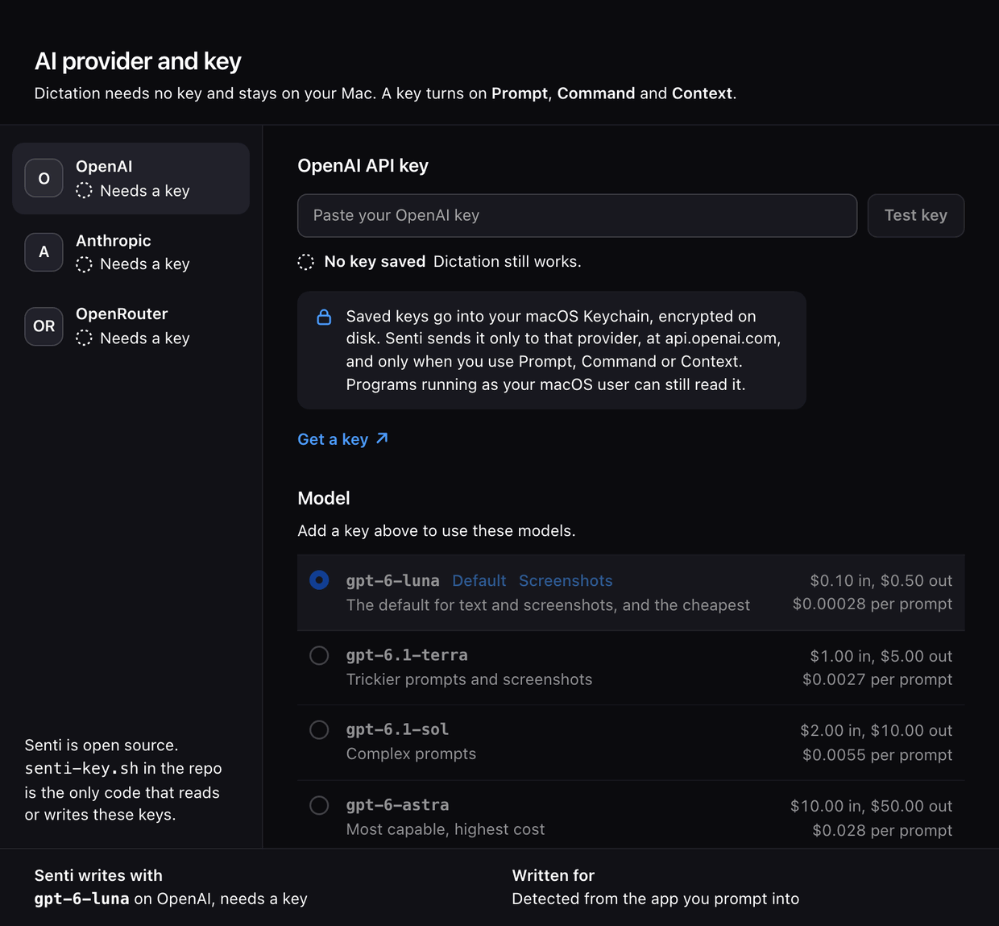

<p align="center">
  
</p>

<h1 align="center">Senti</h1>

<p align="center"><b>Say a rough idea. Paste a clear prompt.</b><br>
Free, local speech-to-text for macOS.</p>

<p align="center"><a href="https://usesenti.io">usesenti.io</a></p>

<p align="center"><a href="https://github.com/Leonardo-Engineering/Senti/actions/workflows/ci.yml"></a></p>

Hold a key and speak. Senti types what you said into the app you are in, or turns a rough spoken
idea into a clean prompt that keeps what you said and is told to add nothing. Dictation runs on your
Mac and your audio never leaves it.

Senti is free and MIT licensed, with no account.

*Senti* is Italian for "listen."

**Contents:** [Prompt mode](#prompt-mode-what-you-said-written-with-care) · [Modes](#modes) · [Speed](#speed) · [Install](#install) · [AI key](#add-an-ai-key-optional) · [Models](#bring-your-own-ai) · [Second brain](#second-brain) · [Privacy](#privacy-and-security) · [Uninstall](#uninstall) · [How it works](#how-it-works) · [Config](#config)

## What it looks like

<p align="center"></p>

While you hold a key, a small pill at the foot of the screen shows that Senti is listening: bars for
dictation, a "Prompt" label in Prompt mode, then blue bars while the prompt is written. These are
captured from the app's own window.

<p align="center"></p>

The "AI provider and key" panel opens from the menu bar on first run. Dictation needs no key. This
image is rendered from the panel's own HTML in a browser.

## Prompt mode: what you said, written with care

Hold right ⌘, say what you want in your own words, and let go. Senti pastes the message you would
have typed if you had taken the time.

- **It is told to keep what you said.** Numbers, names, files, conditions ("only if", "unless"),
  prohibitions, hedges ("maybe", "about") and commitments ("I'll") are to come through at the strength
  you said them. Spoken forms are written out ("twenty point eleven" becomes 20.11, "login dot ts"
  becomes `login.ts`), your order is kept, and a self-correction leaves only the final value. In the
  tests it lost 4 of 778 such items; what it still gets wrong is listed under "How it was measured".
- **It is told to add nothing.** No role line, no tone, no output format, no "add tests", no step
  you did not ask for. A destination obeys what the prompt says, so an invented requirement is work
  nobody wanted. In the tests below it still added something in 3 of 150 rewrites as judged (6 to 9
  read by hand); version 1.1.1 did in 139 as judged.
- **It leaves a clear prompt alone.** A request that is already complete comes back as you said it
  (the same words in the same order in 10 of 10 test runs, 17 November 2026).
- **It says what is undecided.** When the idea names no result or no target at all ("fix it
  somehow"), the rewriter is told to end with an `Open questions:` line that states what was not said,
  and not to guess. In the tests 8 of the 10 rewrites of vague ideas got one.
- **It writes the same way for every app.** Senti used to add notes on the destination model to the
  rewriter's instructions. Leaving them out had no measured effect either way on 60 test ideas (round
  r6, 17 November 2026, 2 samples each, `gpt-6-luna`, M3 Pro; the held-back ideas, the screenshot path
  and long dictations were not rerun without them). They are off for privacy and size: Senti no longer
  reads Claude Code's session file or Codex's config, and its instructions are 0.8 to 3.4 KB shorter.
  The other numbers on this page were measured with the notes on. The notes (`prompts/models/*.md`, a
  section per model, 20 in all, written from each lab's own pages) stay in the repo, and a weekly check
  keeps them current (see CONTRIBUTING.md). `WF_TARGET_NOTES=1` in `config.local.sh` adds them back;
  Senti then picks them from the app in front, its window title, Claude Code's session file and
  Codex's config, all locally.
- **It can see your screen.** With **Use a screenshot in Prompt** on (the default), Prompt mode also
  sends a downscaled screenshot. The rewriter is told to use it for 2 things only: to name what
  "this" or "here" points at, and to spell a name or file that is visible, and never to add a task.
  With 1 unrelated screenshot in the tests, nothing from it got into a prompt. Turn it off in the menu
  bar for text only.
- **It remembers each window, when you ask it to.** A session is a window, so 4 Claude Code terminals
  are 4 separate contexts. Open a turn with **"think hard"** or **"today let's work on"** and Senti
  adds the window title's project and task and your recent turns in that window, to settle what
  "this" means and how a misheard name is spelled. Every other turn stays lean and sends none of that.
- **It can use your notes, if you turn that on.** If you keep an Obsidian vault or Notion pages, a
  heavy turn can add a short digest of your notes for the project you are in. See
  [Second brain](#second-brain).

Every AI mode also gets `prompts/operating.md` prepended, a short set of rules that keeps the output
brief.

### How it was measured

On 16 and 17 November 2026, 75 spoken ideas (15 kinds, 5 destinations, written in transcript style)
went through this version, through Senti 1.1.1, and through 7 prompts that other tools publish, all
on the same model (`gpt-6-luna`), 2 samples each, on an M3 Pro. Counts are rewrites out of 150 unless
a column says otherwise. The method, and how to run it, are in CONTRIBUTING.md under
"Measuring Prompt mode".

| Rewriter | Added something not said | Said items lost (of 778) | Checks for a withdrawn, misheard or wrong value that fired (of 74) | Fits the destination's shape | Clear prompt kept (of 10) | Answers compared with Senti's: Senti better, other better, tied (75 ideas) |
|---|---|---|---|---|---|---|
| **Senti, this version** | 3 | 4 | 1 | 150 | 10 | |
| Senti 1.1.1 | 139 | 20 | 1 | 114 | 0 | 28, 15, 32 |
| No rewrite (the transcript itself) | 1 of 75 | 0 of 389 | 14 of 37 | 75 of 75 | 5 of 5 | 19, 22, 34 |
| Handy, "Improve Transcriptions" | 2 | 0 | 19 | 150 | 10 | 25, 15, 35 |
| OpenWhispr, cleanup prompt | 4 | 2 | 11 | 150 | 10 | 21, 9, 45 |
| Kilo Code, enhance prompt | 115 | 17 | 4 | 150 | 0 | 29, 12, 34 |
| GolfCloud's "Codex" mode for Superwhisper | 86 | 28 | 2 | 150 | 2 | 26, 18, 31 |
| Roo Code, enhance template | 122 | 29 | 6 | 150 | 0 | 45, 7, 23 * |
| Prompt Boost for GitHub Copilot | 145 | 24 | 7 | 11 | 0 | 42, 5, 28 * |
| OpenAI's prompt-generation meta-prompt | 149 of 149 | 25 | 14 | 18 | 0 | 43, 10, 22 * |

What the columns count:

- **Added something not said.** A judge that was shown the speech listed at least 1 addition. An
  `Open questions:` line is not counted, because it is the place for what is undecided. Only Senti
  writes one: in 10 of 150 rewrites, 2 of them on a request that was not vague and did not need it.
  The judge misses some additions; see the hand count below.
- **Said items lost.** A check in code that each number, name, path, condition word and hedge of the
  idea is still there. It checks presence, not meaning: a prohibition turned around would pass. A
  judge checks meaning separately; it caught 12 of 12 planted ones and missed 1 real one (below).
- **Checks for a withdrawn, misheard or wrong value that fired.** Each check looks for a value the
  speaker took back ("three, no wait, five"), a joke instruction they walked back, a name the
  recognizer misheard, or a number written wrongly, still in the rewrite. The unit is checks, not
  values: 2 checks can cover 2 spellings of 1 value, and a value named only to rule it out ("not June
  6") still fires. 10 of the 75 ideas are turns where the right name is only in the window title.
  Senti sees that title on those turns; of the published prompts only GolfCloud's has a place for it
  and was given it. The others were not, which is how those tools work, and it accounts for part of
  their count here.
- **Fits the destination's shape.** No XML tag (except around material the speaker will paste,
  outside Codex and ChatGPT), heading, bold label, role line, preamble, closing offer, code fence or
  quotes around the whole text, no request to share a file with a coding agent, and no bullet list or
  checklist label in ChatGPT.
- **Clear prompt kept.** 5 prompts that were already good, 2 samples each: 90% or more of the words
  come back in order and the result is at most 15% longer. The same words in the same order: this
  version 10 of 10, OpenWhispr 8, Handy 6.

What this shows, and what it does not:

- **It is the only rewriter here that is low on every faithfulness column at once.** Handy adds
  less (2) and loses nothing, but keeps 19 of 74 withdrawn, misheard or wrong values (OpenWhispr 11).
  The prompts that expand a request add something in 86 to 149 of 150 rewrites.
- **What it still gets wrong, read by hand.** 2 of its 4 lost items are honest rewordings. The
  other 2, the 1 withdrawn value and 2 of the 3 judged additions are 1 idea, a correction inside a
  range ("from 26 to 28, no hold on, 30" came out as "from 30 to 30" and "from 30 to 28"). The third
  judged addition turned "go by how long a game takes first" into "Rank them by how long a game takes
  first". The
  judge missed 3 more additions: a `$` on an amount said without a unit (2 rewrites) and a task word
  taken from the window title (1). Counting those, the additions are 6 of 150, and 9 if a unit carried
  over from earlier in the sentence also counts ("worth two hundred" after "a fifty dollar credit").
  It also merged 2 separate exclusions into 1 clause in 2 rewrites, and left "the reply to this"
  unresolved in 2.
- **The answers.** A stand-in for the destination answered every rewrite, and the answers were
  compared head to head against the speaker's full intent. A star marks a lead that holds after
  correcting for 10 comparisons (the 9 in the table and 1 fixed skeleton we wrote ourselves, not shown
  because it is nobody's published prompt). This version is ahead of the 3 starred prompts. Against
  1.1.1 the count is 28 to 15 (p = 0.07, not a result; 3 earlier revisions of the same instructions
  scored 30 to 11, 30 to 16 and 26 to 15). Against Kilo Code (29 to 12) and OpenWhispr (21 to 9) the
  gap is below 0.05 before the correction and not after it. Against GolfCloud (26 to 18), Handy (25 to
  15) and no rewrite at all (19 to 22) there is no result. The same version scored twice differs by 17
  to 19, so gaps of that size mean nothing.
- **Why level is the ceiling.** A rewrite written with the speaker's full intent in hand scored 16
  to 11 against the raw transcript, which is also no result. A capable destination copes with a spoken
  request. A rewriter earns its place by doing no harm, by writing values and names correctly, and by
  naming what was left open, not by making a clear request "better". 1.1.1 lost to the raw transcript
  12 to 32.
- **Tuning ideas and held-back ideas.** 15 variants of the instructions were tried on 60 of
  the ideas. The other 15 were held back from tuning. They were not untouched: 3 earlier revisions
  were also scored on them, and after a reviewer named 1 held-back idea, 2 revisions of the rule about
  "this" after "think hard" quoted its opening words (1 of those was scored on it). The wording was
  changed, and that idea no longer counts as unseen. Side by side, this version (1.1.1 in brackets):

  | | 60 tuning ideas | 15 held-back ideas |
  |---|---|---|
  | Added something not said | 1 of 120 (111) | 2 of 30 (28) |
  | Said items lost | 2 of 628 (18) | 2 of 150 (2) |
  | Withdrawn, misheard or wrong values kept | 0 of 62 (0) | 1 of 12 (1) |
  | Fits the destination's shape | 120 of 120 (89) | 30 of 30 (25) |
  | Requirements met by the destination's answer | 93.2% (90.4%; no rewrite 91.5%) | 91.3% (99.3%; no rewrite 98.1%) |
  | Answers head to head against 1.1.1 | 25, 11, 24 | 3, 4, 8 |

  On the held-back ideas the gap in additions is still clear (fewer than 1.1.1 in 14 ideas, more in
  none; sign test p = 0.0001; read by hand this version's count is 3 of 30, the third being the title
  word). Lost items are level with 1.1.1 (this version's are all in the range idea). The gaps in shape
  and in the answers are not a result at 15 ideas, and the answers lean the other way.
- **Published prompts, not products.** Each prompt was fetched from its own repository or page on 16
  November 2026 and run on `gpt-6-luna`, not on the model its tool uses. Handy and OpenWhispr are
  dictation cleaners and were never meant to write prompts; OpenAI's meta-prompt is written to produce
  system prompts. GolfCloud's mode runs inside Superwhisper, whose own request format is not public,
  so its input here (the speech as "User Message", the app and window title as "Application Context")
  is our assembly. A tool can behave differently from its prompt. Sources: Handy
  `src-tauri/src/settings.rs` (4a096e3), OpenWhispr `src/locales/en/prompts.json` (522c14e), Kilo
  Code `packages/opencode/src/kilocode/enhance-prompt.ts` (12b44cb), Roo Code
  `src/shared/support-prompt.ts` (cf5d42e), GolfCloud `superwhisper-toolkit/prompts/codex.xml`
  (b0a52c4), Prompt Boost `src/promptBoost.ts` (a51923c), and
  developers.openai.com/api/docs/guides/prompt-generation.
- **Limits.** The destination was a stand-in (the same small model writing a plan or an answer), not
  a real agent run. The ideas were written, not recorded. The judges were the same model, shown the
  speech (and, for the answers, the speaker's full intent) and never told which rewriter wrote a text.
- **With a screenshot.** The same 75 ideas with 1 unrelated, tempting screenshot (a planning document
  with its own to-do lines): this version was judged to add something in 1 of 150 rewrites, 1.1.1 in
  148 of 150, and clear prompts came back with the same words in the same order in 9 of 10. Nothing
  from the screenshot got into this version's prompts (1.1.1 copied a function name and to-do lines
  from it into some). The 1 flagged rewrite is worse than an addition: "not for
  Alaska and Hawaii, and not when the package is over twenty pounds" came out as "except for Alaska
  and Hawaii, and when the package is over 20 pounds", which turns the second exclusion around, and the
  judge that checks meaning passed it. Whether a relevant screen helps was not measured.
- **Long dictation.** The 75 ideas are 8 to 50 words, so 15 more were written of 228 to 278 words each,
  with digressions, self-corrections and withdrawn ideas (17 November 2026, 2 samples each, same model;
  the rules for reading the result were written down before the run). Said items lost, counted in code
  and then read by hand: this version 0 of 444, 1.1.1 15 of 444, in 8 of its 30 rewrites (one dropped
  both requests of an email, another the topic of a lesson plan); this version lost fewer in 6 ideas
  and more in none (sign test p 0.031). The code first counted 4 and 37: rewordings such as "confirm
  its decision in writing" were then accepted for every rewriter. Only this version's 30 rewrites were
  also read in full: 3 dropped something outside the list, 1 of them a prohibition ("don't include
  medical details"). It was judged to add something in 1 of 30, and in 4 of 30 when the same version
  was run again; read by hand 5 of 30, all small ("apartment", a guessed `waitUntil`), 7 if a
  carried-over unit counts ("$" on amounts said without "dollars"). Every withdrawn value and misheard
  name was handled; on the transcript itself 15 of the 16 checks for them fired. The answers are no
  result at 15 ideas: against the transcript 4 better, 6 worse, 5 tied (leaning to the transcript),
  against 1.1.1 7, 3, 5, and the same version against itself 1, 6, 8.

## Modes

| Gesture | Mode | What it does |
|---|---|---|
| Hold **right ⌥** | **Dictate** | Types exactly what you say. Fully local. |
| Hold **right ⌘** | **Prompt** | Turns a rough spoken idea into a clean prompt that keeps what you said and is told to add nothing. Adds a screenshot when that setting is on and Hammerspoon has Screen Recording permission; otherwise text only. |
| Hold **Fn** | **Command** | Transforms the text you selected by voice ("make this a bullet list", "fix the grammar"). Sends your words and the selection. With no selection there is nothing to edit, so it writes a prompt from what you said, exactly as right ⌘ does. |
| **⌃⌥V** | **Context** | Takes a screenshot plus your instruction, then drafts a reply, edit or answer at the cursor. Press it, speak, and press it again to stop. |
| `⌃⌥D` / `⌃⌥P` / `⌃⌥C` | Toggles | Hands-free versions of Dictate, Prompt and Command. |
| `⌃⌥L` | **Paste last** | Pastes the last result again. Senti keeps it in memory for 5 minutes, never on disk, and forgets it when the screen locks. |

A small pill at the bottom of the screen shows your live microphone level while you speak, then
disappears. Things worth knowing:

- **Cancelling.** Press Esc while the pill is showing. A key pressed in the first 1.5 seconds of a hold
  also cancels quietly, so right ⌘+C or Fn+arrow still work as shortcuts. A click does not cancel (you
  may be placing the cursor), but a hold under 3 seconds with a click and no speech ends without an alert. Esc cannot cancel while an app
  has secure keyboard entry on (a password field, or Terminal's Secure Keyboard Entry); the menu says
  when that is the case.
- **Toggles.** `⌃⌥D`, `⌃⌥P` and `⌃⌥C` start a recording, and the same shortcut stops it.
- **Limits.** A recording stops itself after 150 seconds and puts the text on the clipboard without
  pasting. An AI request that has not answered after 75 seconds is abandoned and your words are handed
  back.
- **How it types.** Senti pastes through the clipboard and then puts your clipboard back. If Option,
  Control, Fn or Shift are still held it waits for them; if they stay held the text goes to the clipboard.
- **Cleanup.** Dictation drops filler words (um, uh, erm, hmm) and one opening "So," "Okay," "Well," or
  "Like,". `WF_REMOVE_FILLERS=0` in `config.local.sh` turns that off. Start and stop sounds:
  `WF_SOUNDS=0` silences them.
- **Switching windows.** If you move to another window or tab before the text arrives, Senti does not
  type it there: it puts it on the clipboard and says so. An unread count or a spinner in the title is
  not a switch.
- **While Senti is busy.** A hold key pressed while Senti is still writing the last result does not
  start a new recording: after 0.4 seconds it says so, and the earlier result is typed when you let go.
  Speed, Language and Restart engine in the menu wait until Senti is idle, because changing them
  mid-turn would lose the words in flight.
- **Another dictation tool on the same keys.** Senti checks whether Wispr Flow is running and warns you,
  because Wispr Flow's default dictation key is also Fn (on the Mac tested, its prompt shortcut also
  answered right ⌘).

The menu-bar icon holds the language, the speed setting (Accurate, Fast or Parakeet), the AI provider,
key and model, a switch to mute other audio while recording, your snippets, permissions and an engine
restart.

## Speed

Measured on an M3 Pro on 13 November 2026, with recorded clips on the default (Accurate) speech model,
from letting go of the key until the text is ready to paste:

- about 0.5 to 0.6 seconds for a dictation under 14 seconds, and about 1 to 1.1 seconds for a longer one.
  Since 15 November Senti also keeps recording for 100 ms after you let go, so your last word is not
  cut; that adds about 0.13 seconds to these figures (`WF_TAIL_MS=0` in `config.local.sh` turns it off);
- on the Fast model (`base.en`), 0.2 to 0.4 seconds in the same day's tests, measured before this
  release's speedups.

A prompt rewrite with `gpt-6-luna` took 1.5 to 3.0 seconds without a screenshot (median 1.7, 20
runs on 17 November 2026; version 1.1.1 on the same 20 ideas, run alternately: median 2.4). With a
screenshot it took 1.5 to 2.9 seconds (median 2.0, 10 runs with a synthetic screenshot the same day;
1.1.1: median 4.4). The new prompts are shorter: about 39 output tokens against about 62, with about
2,200 input tokens against about 1,500 (with the per-model notes on; without them Senti's
instructions are 0.8 to 3.4 KB shorter). Almost all of the time is the AI model's own. The screenshot is now shrunk while you are still
speaking, which took about 0.07 seconds off Senti's own work after you let go of the key.

The speech model stays loaded so dictation starts fast. On the same Mac the speech server used about
716 MB of memory with the default model (`footprint`, 13 November 2026).

## Install

You need:

- a Mac with Apple Silicon (M1 or later). The installer stops on any other Mac;
- [Homebrew](https://brew.sh);
- [Hammerspoon](https://www.hammerspoon.org), which Senti runs inside. `install.sh` offers to
  install it with Homebrew if it is missing;
- the Xcode Command Line Tools (`xcode-select --install`). They are needed once, to build the helper
  that shows the Microphone permission prompt; `install.sh` builds it only when they are present;
- about 0.6 GB of disk for the default speech model (574 MB), plus about 80 MB for the Homebrew
  packages themselves, not counting libraries they pull in (measured 13 November 2026).

The installer does not check the macOS version. Senti was tested on macOS 27.0.1, where the offline
self-test of this version passed on 17 November 2026.

```bash
git clone https://github.com/Leonardo-Engineering/Senti.git ~/code/senti
cd ~/code/senti && ./install.sh
```

**Update.** Senti has no update check. To update, pull and run the installer again:

```bash
cd ~/code/senti && git pull && ./install.sh
```

What `install.sh` does, in order:

1. Checks for `whisper-cpp`, `sox`, `resvg` and Hammerspoon, and offers to install any that are
   missing with Homebrew (`brew install`, and `brew install --cask hammerspoon`).
2. Downloads the speech model (574 MB) and checks it against its published SHA-256. A download that
   does not match is deleted.
3. Copies Senti's scripts and settings to `~/.config/senti`.
4. **Replaces `~/.hammerspoon/init.lua`** with Senti's. If you already had your own `init.lua`, it is
   first saved as `init.lua.pre-senti.<date>-<time>` in the same folder.
5. Installs a LaunchAgent (`io.senti.server`) that keeps the speech server running on `127.0.0.1`,
   and `~/Applications/Senti.app`, an on and off switch: opening it starts Senti, and opening it again
   while Senti runs quits Hammerspoon.
6. Moves a key file left by an older install into the Keychain (`senti-key.sh migrate`; the file is
   deleted only after the Keychain copy reads back the same). Then it offers to add an AI key (see
   below) when none is stored yet. The offer is skipped with `--yes`; the move is not.

Senti also sets Hammerspoon to open at login and hides Hammerspoon's own menu-bar and Dock icons (its
own icon replaces them). To start Senti after installing, open Hammerspoon or `Senti.app`.

`./install.sh --yes` installs missing pieces without asking. Running it again later updates Senti.
Put your own settings in `~/.config/senti/config.local.sh`: `install.sh` never overwrites that file.
`config.sh` holds the defaults and is replaced on every update (the previous one is kept as
`config.sh.v<N>.bak`). The first update from an older install moves the settings you had added to
`config.sh` into `config.local.sh` for you, and lists any line it was unsure about there as a comment.
Your `replacements.txt`, `snippets.txt`, `brain-map.txt` and eval cases are kept.

The [Releases page](https://github.com/Leonardo-Engineering/Senti/releases/latest) has the same
source. Releases from 1.1.0 on attach a source tarball (`senti-<version>.tar.gz`) and a `SHA256SUMS` file. Check
your download in the folder you saved both files to:

```bash
shasum -a 256 -c SHA256SUMS
```

**Permissions.** Senti runs inside Hammerspoon, so the macOS permission prompts name
**Hammerspoon**, not Senti:

- **Accessibility** (to see the hold keys and type): usually prompted on first use.
- **Microphone**: menu-bar icon → *Grant / test microphone* → Allow.
- **Screen Recording** (only for Context, and for Prompt with screenshots): menu-bar icon → *Grant
  screen recording*, then relaunch Hammerspoon.

**Language.** English by default. Pick another language, or automatic detection, in the menu bar
(Language). Detection adds 0.3 to 0.8 seconds to each dictation. Any other Whisper language code works
as `WF_LANG` in `~/.config/senti/config.local.sh` (`es`, `pt`, `zh`, `yue` and so on; a code Whisper
does not know falls back to English). The opening phrases that ask for more context in
Prompt mode ("think hard", "today let's work on") are English only.

**Fast model (optional).** For a faster, English-only model, download it (148 MB) and switch in the
menu bar (Speed, then Fast). This download is not checksum-verified:

```bash
curl -L -o ~/.local/share/whisper-models/ggml-base.en.bin \
  https://huggingface.co/ggerganov/whisper.cpp/resolve/main/ggml-base.en.bin
```

**Parakeet (optional).** NVIDIA's Parakeet model runs through the `parakeet-cli` that Homebrew's
whisper-cpp already installs. Measured on an M3 Pro on 15 November 2026, key-up to text: a 4 second clip took 0.40
seconds against 0.50 for the default model, a 13 second clip 0.50 against 0.58, and a 21 second clip
0.62 against 1.09. The gain is mostly on dictations longer than 14 seconds. It detects the language itself among 25 European ones (the Language menu does not steer it, and for any other language Senti uses the default model) and takes no vocabulary hint, so
project names lean on your `replacements.txt`. Download the model (669 MB), check it, then pick
Speed, then Parakeet in the menu bar. Senti uses Parakeet for dictations under 30 seconds and the default model for longer ones and whenever
Parakeet fails or takes longer than 10 seconds (`WF_PARAKEET_TIMEOUT`, 1 to 30). On real recorded speech the 2 engines were close in accuracy; the default model stays the default.

```bash
curl -L -o ~/.local/share/whisper-models/ggml-parakeet-tdt-0.6b-v3-q8_0.bin \
  https://huggingface.co/ggml-org/parakeet-GGUF/resolve/main/ggml-parakeet-tdt-0.6b-v3-q8_0.bin
shasum -a 256 ~/.local/share/whisper-models/ggml-parakeet-tdt-0.6b-v3-q8_0.bin
# 4d64e9e96c2792186d072fde0034df0ad670cf680a2f53069052ead827fd600e
```

The model is NVIDIA's `parakeet-tdt-0.6b-v3` (CC-BY-4.0), converted by the whisper.cpp project.

## Add an AI key (optional)

Dictation never needs a key. Prompt, Command and Context use your own key for one of the providers
below. There are 2 safe ways to add it:

- **The panel.** Menu bar → **AI provider and key…**. It opens by itself once, on the first run with
  no key. Pick a provider, paste the key, and Senti saves it and checks it against the provider's free
  model or key list.
- **The terminal.** Run this and paste the key at the hidden prompt:

  ```bash
  bash ~/.config/senti/senti-key.sh set openai      # or anthropic, or openrouter
  ```

  The key is read from the prompt or standard input, never from the command line, so it does not
  land in your shell history or in the process list.

Keys are stored in your macOS Keychain, encrypted on disk. Senti sends a key only to that provider.
Programs running as your macOS user can still read it. If the Keychain is locked or unavailable,
Senti saves the key in a mode-600 file under `~/.config/senti` instead and tells you so.

```bash
bash ~/.config/senti/senti-key.sh status          # which keys exist, last 4 characters only
bash ~/.config/senti/senti-key.sh test openai     # checks the key with the provider
bash ~/.config/senti/senti-key.sh clear openai    # removes it
```

Never type or paste a key into a command line (an `echo` into a file, for example): it stays in your
shell history.

## Bring your own AI

| Provider | Default model |
|---|---|
| OpenAI | `gpt-6-luna` (the default provider) |
| Anthropic | `claude-haiku-5-5` |
| OpenRouter | `openai/gpt-6-luna` |

The model list and the prompting knowledge behind Prompt mode are checked every week against what the
labs have released (`tools/models-watch.py`; see CONTRIBUTING.md, "Keeping the model knowledge current").

Add a key for any of them in the menu bar ("AI provider and key...") or with
`bash ~/.config/senti/senti-key.sh set <provider>`, then pick a model in the same menu.

Prices are US dollars per 1 million tokens, from `ai-models.json`. OpenAI prices were checked on
11 November 2026 on [OpenAI's pricing page](https://developers.openai.com/api/docs/pricing). Anthropic prices
were checked on 15 November 2026 on [Anthropic's pricing page](https://platform.claude.com/docs/en/about-claude/pricing). OpenRouter prices come from OpenRouter's
model list, fetched 13 and 14 November 2026; 2 that had changed by 15 November (Kimi and DeepSeek) were updated
that day. Through OpenRouter one key reaches models from 10 labs; the list
is picked from OpenRouter's catalog and its most-used models.

**OpenAI**

| Model | Use it for | Input | Output |
|---|---|---|---|
| `gpt-6-luna` | The default for text and screenshots, and the cheapest | $0.10 | $0.50 |
| `gpt-6.1-terra` | Trickier prompts and screenshots | $1.00 | $5.00 |
| `gpt-6.1-sol` | Complex prompts | $2.00 | $10.00 |
| `gpt-6-astra` | Most capable, highest cost | $10.00 | $50.00 |

**Anthropic**

| Model | Use it for | Input | Output |
|---|---|---|---|
| `claude-haiku-5-5` | The default when the provider is Anthropic: the fastest Claude, at the price of `gpt-6-luna` (prompts up to 100K tokens) | $0.10 | $0.50 |
| `claude-sonnet-5-5` | Claude at a middle price | $2.00 | $10.00 |
| `claude-opus-5-5` | Claude, most capable, at 40 times the default's price | $4.00 | $20.00 |

**OpenRouter**

| Model | Use it for | Input | Output |
|---|---|---|---|
| `openai/gpt-6-luna` | The default when the provider is OpenRouter | $0.10 | $0.50 |
| `anthropic/claude-haiku-5.5` | Claude, cheapest | $0.10 | $0.50 |
| `anthropic/claude-sonnet-5.5` | Claude, middle price | $2.00 | $10.00 |
| `anthropic/claude-opus-5.5` | Claude, most capable | $4.00 | $20.00 |
| `google/gemini-3.8-flash` | Google Gemini, a lower-cost option | $0.825 | $4.125 |
| `google/gemini-4-hydrogen` | Google's newest Gemini | $1.50 | $7.50 |
| `moonshotai/kimi-k3.1-pro` | Moonshot's newest Kimi | $2.30 | $11.50 |
| `x-ai/grok-4.7` | xAI's newest Grok | $2.00 | $6.00 |
| `mistralai/mistral-large-4-0` | Mistral's newest large model | $0.70 | $2.10 |
| `qwen/qwen3.8-omni-flash` | Qwen, fast and low cost | $0.15 | $0.47 |
| `minimax/minimax-m3.1-flash` | MiniMax, fast and low cost | $0.15 | $0.60 |
| `deepseek/deepseek-v4.1-flash` | DeepSeek, fast and very low cost | $0.14 | $0.42 |
| `z-ai/glm-5.3-flash` | GLM, the lowest cost here | $0.04 | $0.078 |

Every OpenRouter request asks OpenRouter to use only model hosts that do not store or train on the
data (`data_collection: deny`).

**Switching.** Pick a provider and model in the menu bar (**AI → Model**), or run:

```bash
bash ~/.config/senti/senti-key.sh use openai gpt-6.1-terra
```

A `WF_AI_PROVIDER`, `WF_TEXT_MODEL` or `WF_VISION_MODEL` line in `~/.config/senti/config.local.sh`
outranks the menu choice. Add one only if you want a fixed pin. (Put settings in `config.local.sh`:
`config.sh` holds the defaults and every update replaces it.)

With an Anthropic Opus or Sonnet model, a request the model declines is re-run by Anthropic on another
of its models. `WF_ANTHROPIC_FALLBACKS=0` turns that off.

Models and prices change. To check whether your key can use a model right now:

```bash
bash ~/.config/senti/senti-key.sh test openai --model gpt-6.1-terra   # look for "model_listed":true
```

## Second brain

Prompt mode can send a short digest of your own notes with a heavy turn (one that opens with "think
hard" or "today let's work on"). There are 2 sources, Obsidian and Notion. Both are off until you turn
them on, and you can use either or both. No other turn sends anything from your notes. Since 17
November 2026 the rewriting rules say to use reference context, notes included, for 2 things only: to
name what "this" points at and to spell a name, and to add nothing you did not say. The digest itself
is introduced the same way: as reference only, to name what the idea points at and to spell names,
adding no task, fact or requirement and never changing a value you said. What a note digest does to a
prompt has not been measured on the current rules.

**Obsidian.** Senti reads only the vault folders you list, so don't list one that holds notes about
people. It picks the note for the project in the window title and sends its `## Senti` section if it
has one, otherwise its `## For future Claude` section, otherwise its first 10 lines, capped at 700
bytes. Notes and folders that resolve outside the listed folders, including through symlinks, are
ignored. Senti looks for the vault at `~/Documents/Obsidian Vault`; set `WF_VAULT` if yours is elsewhere.
Add to `~/.config/senti/config.local.sh`:

```bash
WF_BRAIN=1
WF_BRAIN_DIRS=$'Projects\nWork'   # vault folders Senti may read, one per line
```

`WF_BRAIN_RETRIEVE=1` also adds one more note from the same project folder: the one whose words best
match what you said, found by a keyword search on your Mac (nothing is indexed to disk), capped at
700 bytes. It is off by default. On 14 November 2026, with the earlier instructions (which let a
note's facts into the prompt), on 12 test requests over a sample vault it put a fact from the
right note into 28 of 33 prompts (3 of 33 without it), but a judge that compares prompts without
seeing the notes preferred the prompts without it: 2 wins, 29 losses, 5 ties, against 11 wins, 17
losses and 8 ties for the same setup compared with itself.

**Notion.** Senti reads only the pages you map to a project, and a Notion connection can only read
pages you shared with it.

1. In Notion's Developer portal, create an internal connection for your workspace and give it read
   access to content. Copy its API token from the Configuration tab. (A personal access token also
   works, but it can read every page you can, so an internal connection is the safer choice.)
2. Share each page with it: on the page, open the ••• menu, choose Connections, then + Add connection.
3. Store the token in your macOS Keychain. Senti asks for it with the input hidden:
   `bash ~/.config/senti/senti-key.sh set notion`
4. Map the page to a project in `~/.config/senti/brain-map.txt`, one line per project:
   `myproject|notion:https://www.notion.so/My-Page-0123456789abcdef0123456789abcdef`
5. Turn it on in `~/.config/senti/config.local.sh`: `WF_BRAIN_NOTION=1`

On a heavy turn in a mapped project, Senti reads the page from Notion after you stop speaking. That
request carries the page id and your token, nothing from your speech or window title, and Senti never
uses Notion's search. The page goes through the same rules as an Obsidian note (a heading named Senti
wins), and the result is kept for 10 minutes so the next heavy turn does not wait. A read that fails
or takes longer than 2.5 seconds sends nothing from Notion.

**What leaves your Mac.** Each digest goes to your AI provider inside that heavy turn's request,
marked as reference data. The log records each one as a count, for example
`sent: vault 'Note.md' 412 chars` or `sent: notion 'Notion page 1a2b3c4d' 380 chars`. To see what would
be sent, without sending anything to your AI provider: `bash ~/.config/senti/senti-brain.sh --preview <project>`
(this reads the mapped Notion page from Notion).

## Privacy and security

- Dictation is fully local. The audio goes to a whisper.cpp server bound to `127.0.0.1`.
- Prompt, Command and Context send text, and a downscaled screenshot where described above, only to
  the provider you chose, and only when you press their key. Nothing is uploaded in the background.
- Menu bar → **AI → What the last AI request sent** shows what the last request carried, as names and
  character counts.
- Your speech, the system prompt and your keys never go on a command line, where any process could
  read them. The self-test checks this with canary strings.
- Untrusted text, including a browser tab's title, is fenced and marked as data the AI is told not to
  follow. The AI's output is only ever typed, never run.
- The `hs` command-line bridge, which would let any process on your Mac run code inside Hammerspoon,
  is off by default.
- The log stores counts, not transcripts. Audio and screenshots are deleted when each turn ends, with
  a 60-second backstop.

[`PRIVACY.md`](PRIVACY.md) lists exactly what leaves your Mac in each mode and what is stored for how
long. [`SECURITY.md`](SECURITY.md) has the threat model and how to report a problem.

## Uninstall

From your copy of the repository:

```bash
./uninstall.sh
```

It lists what it will remove and asks first. Every question defaults to No. Hammerspoon itself stays
installed. The uninstaller turns its Dock and menu bar icons back on (only when Senti's config was the one in
place); it still opens at login until
you untick that in Hammerspoon's preferences, or remove Hammerspoon if you no longer use it. It:

- stops and removes the speech server's LaunchAgent;
- puts back your previous `~/.hammerspoon/init.lua` from the newest `init.lua.pre-senti.*` backup
  when the current `init.lua` is Senti's, or when there is none.
  Your current `init.lua` is saved as `init.lua.senti-<date>.bak` before your old one is restored, so edits you made inside Senti's file are kept in that copy.
  An `init.lua` that no longer contains Senti's code is kept, and the backup's location is printed.
  With no backup, Senti's `init.lua` is removed;
- removes `~/Applications/Senti.app` (and a Desktop copy if you made one), `~/.cache/senti` and
  Senti's logs;
- asks separately whether to remove `~/.config/senti` together with your keys in the Keychain, and
  whether to remove the speech models in `~/.local/share/whisper-models` (other tools may use them).

`./uninstall.sh --yes` removes Senti without asking and leaves `~/.config/senti`, your keys and the
speech models in place.
`./uninstall.sh --yes --all` removes those too. Homebrew packages are never removed; the last lines
print the `brew uninstall` command if you want them gone. Hammerspoon keeps running the old config
until you reload or quit it.

## How it works

```
hold key ─▶ Hammerspoon (senti.lua) ─▶ sox records mic ─▶ SIGINT finalizes WAV
                                                              │
        types via ⌘V ◀─ clean/format/dictionary ◀─ whisper-server (127.0.0.1, warm) ◀┘
                                          │
   prompt/command ─▶ senti-ai.sh ─▶ your provider (OpenAI, Anthropic or OpenRouter)
   context/prompt+screen ─▶ senti-vision.sh ─▶ senti-ai.sh (with a downscaled screenshot)
   prompt mode also ─▶ senti-target.sh (notes on the destination model, only with WF_TARGET_NOTES=1)
                   ├─▶ senti-session.sh (this window's recent turns, heavy turns only)
                   └─▶ senti-brain.sh  (your Obsidian note and Notion page for this project, if on)
```

- `senti-serve.sh`: the warm whisper.cpp server (launchd `io.senti.server`).
- `senti-dictate.sh`: record, stop, transcribe, clean, silence gate, dictionary.
- `senti-ai.sh`: the one AI call, text and vision, for every provider. Prepends the operating layer.
- `senti-key.sh`: stores, tests and reports keys (Keychain), and picks the provider and model.
- `senti-target.sh` / `senti-session.sh` / `senti-brain.sh`: per-model notes (off by default), per-window memory, notes.
- `senti-prompt.sh`: Prompt mode without a screenshot.
- `senti-vision.sh`: Context, and Prompt with a screenshot.
- `senti-command.sh`: transforms selected text.
- `tools/prompt-eval.py` with `eval/cases2.jsonl` and `eval/cases-long.jsonl` (repo only): measures Prompt mode. See CONTRIBUTING.md.
- `senti-judge.sh` / `senti-eval.sh`: the older prompt judge and harness, kept for their history.
- `senti-selftest.sh`: the check suite. `--ci` runs it offline from a checkout.
- `senti-model.sh`: switches the speech model (Accurate, Fast, Parakeet) and the language.
- `senti-config.sh`: installs the default settings and carries yours into `config.local.sh`.
- `senti-mic-auth.swift`: brings up the macOS microphone permission prompt.
- `senti.lua`: Hammerspoon hotkeys, pill, menu bar, key panel, state machine and watchdog.
- `install.sh` / `uninstall.sh`: put Senti on your Mac and take it off.

## Config

Your settings go in `~/.config/senti/config.local.sh`, which no update touches. `config.sh` beside it
holds the defaults and their explanations, and every update replaces it. Common settings: efforts
(`WF_EFFORT`, `WF_VISION_EFFORT`), screenshot size (`WF_SHOT_PX`), the notes sources (`WF_BRAIN`,
`WF_BRAIN_RETRIEVE`, `WF_BRAIN_NOTION`), the recording tail (`WF_TAIL_MS`), the silence threshold
(`WF_SILENCE_THOLD`, default 0.005) and the operating layer (`WF_OPERATING_LAYER=0` turns it off). The
language is set in the menu bar; a `WF_LANG` line overrides the menu. Edit
`replacements.txt` for vocabulary fixes (for example "cloud md" to `CLAUDE.md`) (each line is what Senti hears, a `|`, and what to type; case does not matter and a rule fires only on a whole word) and
`eval/cases.txt` for the older eval's cases (Prompt mode is measured with `eval/cases2.jsonl` in the
repo; see CONTRIBUTING.md).

`snippets.txt` holds phrases that type a fixed text when you say them on their own, one per line as
`what you say | what to type` (`\n` is a line break). Add a line such as `my email | you@example.com`, say "my email" alone while dictating (right ⌥), and
Senti types the address; say it inside a sentence and nothing changes. The file ships with examples
commented out, and the menu bar has Edit snippets. The file is read on your Mac and never sent anywhere.

`bash ~/.config/senti/senti-selftest.sh` checks the whole install: the speech engine, a transcription
round trip, the config version, keys (presence only), the icon build, session isolation and the
argv canaries. With a key it also makes live AI calls, which cost a fraction of a cent and send a
screenshot of your main display; set `WF_SELFTEST_OFFLINE=1` to skip them.

## Contributing

See [`CONTRIBUTING.md`](CONTRIBUTING.md). [`CLAUDE.md`](CLAUDE.md) maps the repository to the
installed system and lists the macOS gotchas. Changes are listed in [`CHANGELOG.md`](CHANGELOG.md).

MIT licensed, copyright Da Vinci Tech. See [`LICENSE`](LICENSE).
