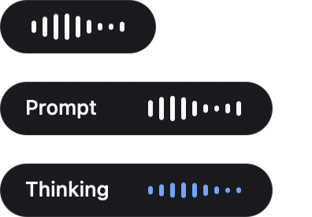
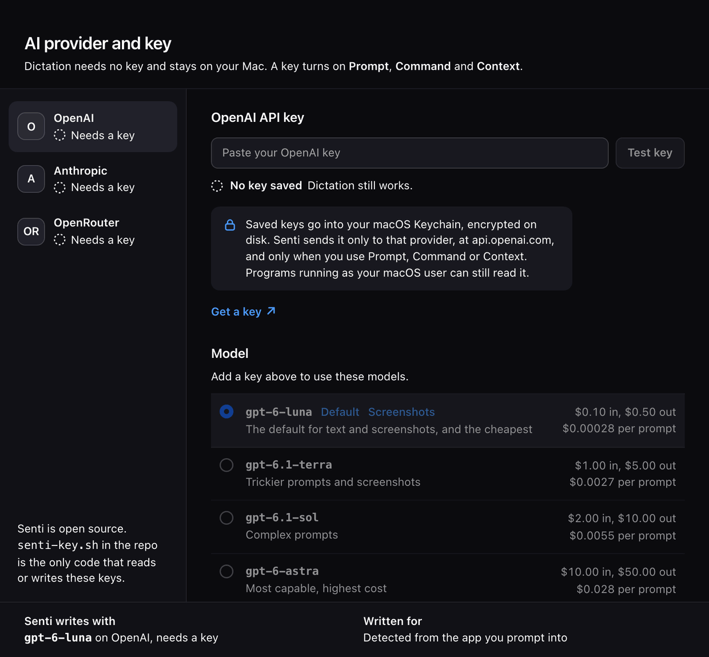

<p align="center">
  
</p>

<h1 align="center">Senti</h1>

<p align="center"><b>Say a rough idea. Paste a clear prompt.</b><br>
Free, local speech-to-text for macOS.</p>

<p align="center"><a href="https://usesenti.io">usesenti.io</a></p>

<p align="center"><a href="https://github.com/Leonardo-Engineering/Senti/actions/workflows/ci.yml"></a></p>

Hold a key and speak. Senti types what you said into the app you are in, or turns a rough spoken
idea into a prompt written for the AI model you are about to paste it into. Dictation runs on your
Mac and your audio never leaves it.

Senti is free and MIT licensed, with no account.

*Senti* is Italian for "listen."

## What it looks like

<p align="center"></p>

While you hold a key, a small pill at the foot of the screen shows that Senti is listening: bars for
dictation, a "Prompt" label in Prompt mode, then blue bars while the prompt is written. These are
captured from the app's own window.

<p align="center"></p>

The "AI provider and key" panel opens from the menu bar on first run. Dictation needs no key. This
image is rendered from the panel's own HTML in a browser.

## Prompt mode: a prompt written for where it is going

Hold right ⌘, say what you want in your own words, and let go. Senti writes a prompt and pastes it
at your cursor.

- **It writes for the model in front of you.** Ask for the same thing in Claude and in ChatGPT and
  you get 2 different prompts. Each follows that model maker's own guidance. The Claude guidance, for
  example, asks for XML tags when a prompt mixes instructions, context and examples; the OpenAI
  guidance asks for a lean prompt with no hand-written "think step by step". The guidance lives in
  `prompts/models/*.md`, distilled from 90 linked sources across OpenAI, Anthropic, Google,
  open-weight models and prompting research. Edit those files and the behavior changes.
- **It knows where you are.** Senti reads the name of the app in front and its window title, and in
  a Claude Code terminal it reads the model name from Claude Code's own session file. All of this is
  local and costs no extra API call.
- **It can see your screen.** With **Use a screenshot in Prompt** on (the default), Prompt mode also
  sends a downscaled screenshot so the prompt fits what you are working on. Turn it off in the menu
  bar for text only.
- **It remembers each window, when you ask it to.** A session is a window, so 4 Claude Code terminals
  are 4 separate contexts. Open a turn with **"think hard"** or **"today let's work on"** and Senti
  adds the window title's project and task and your recent turns in that window. Every other turn
  stays lean and sends none of that.
- **It can use your notes, if you turn that on.** If you keep an Obsidian vault or Notion pages, a
  heavy turn can add a short digest of your notes for the project you are in. See
  [Second brain](#second-brain).

Every AI mode also gets `prompts/operating.md` prepended, a short set of rules that keeps the output
brief.

## Modes

| Gesture | Mode | What it does |
|---|---|---|
| Hold **right ⌥** | **Dictate** | Types exactly what you say. Fully local. |
| Hold **right ⌘** | **Prompt** | Turns a rough spoken idea into a prompt for the model you are about to paste into. Adds a screenshot when that setting is on and Hammerspoon has Screen Recording permission; otherwise text only. |
| Hold **Fn** | **Command** | Transforms the text you selected by voice ("make this a bullet list", "fix the grammar"). Sends your words and the selection. With no selection, it writes at the cursor. |
| **⌃⌥V** | **Context** | Takes a screenshot plus your instruction, then drafts a reply, edit or answer at the cursor. |
| `⌃⌥D` / `⌃⌥P` / `⌃⌥C` | Toggles | Hands-free versions of Dictate, Prompt and Command. |

Press Esc while the pill is showing to cancel. A small pill at the bottom of the screen shows your
live microphone level while you speak, then disappears. The menu-bar icon holds the speed setting
(Fast or Accurate), the AI provider and key, the model picker, permissions and an engine restart.

## Speed

Measured on an M3 Pro on 13 November 2026, with recorded clips on the default (Accurate) speech model,
from letting go of the key until the text is ready to paste:

- about 0.5 to 0.6 seconds for a dictation under 14 seconds, and about 1 to 1.1 seconds for a longer one;
- on the Fast model (`base.en`), 0.2 to 0.4 seconds in the same day's tests, measured before this
  release's speedups.

A prompt rewrite with `gpt-6-luna` took about 2 seconds without a screenshot (median of 5 runs). With
a screenshot it took 1.9 to 3.1 seconds (median 2.5, 15 runs with a synthetic screenshot, 14 November
2026). Almost all of that is the AI model's own time. The screenshot is now shrunk while you are still
speaking, which took about 0.07 seconds off Senti's own work after you let go of the key.

The speech model stays loaded so dictation starts fast. On the same Mac the speech server used about
716 MB of memory with the default model (`footprint`, 13 November 2026).

## Install

You need:

- a Mac with Apple Silicon (M1 or later). The installer stops on any other Mac;
- [Homebrew](https://brew.sh);
- [Hammerspoon](https://www.hammerspoon.org), which Senti runs inside. `install.sh` offers to
  install it with Homebrew if it is missing;
- the Xcode Command Line Tools (`xcode-select --install`). They are needed once, to build the helper
  that shows the Microphone permission prompt; `install.sh` builds it only when they are present;
- about 0.6 GB of disk for the default speech model (574 MB), plus about 80 MB for the Homebrew
  packages themselves, not counting libraries they pull in (measured 13 November 2026).

The installer does not check the macOS version. Senti was tested on macOS 27.0.1.

```bash
git clone https://github.com/Leonardo-Engineering/Senti.git ~/code/senti
cd ~/code/senti && ./install.sh
```

What `install.sh` does, in order:

1. Checks for `whisper-cpp`, `sox`, `resvg` and Hammerspoon, and offers to install any that are
   missing with Homebrew (`brew install`, and `brew install --cask hammerspoon`).
2. Downloads the speech model (574 MB) and checks it against its published SHA-256. A download that
   does not match is deleted.
3. Copies Senti's scripts and settings to `~/.config/senti`.
4. **Replaces `~/.hammerspoon/init.lua`** with Senti's. If you already had your own `init.lua`, it is
   first saved as `init.lua.pre-senti.<date>-<time>` in the same folder.
5. Installs a LaunchAgent (`io.senti.server`) that keeps the speech server running on `127.0.0.1`,
   and `~/Applications/Senti.app`, a menu-bar launcher.
6. Moves a key file left by an older install into the Keychain (`senti-key.sh migrate`; the file is
   deleted only after the Keychain copy reads back the same). Then it offers to add an AI key (see
   below) when none is stored yet. The offer is skipped with `--yes`; the move is not.

`./install.sh --yes` installs missing pieces without asking. Running it again later updates Senti.
When a release changes the config schema (1.1 does: v8 to v9), `install.sh` saves your old file as
`config.sh.v<N>.bak` and installs the new one; copy your personal settings back from that file.
Your `replacements.txt`, `brain-map.txt` and eval cases are kept.

The [Releases page](https://github.com/Leonardo-Engineering/Senti/releases/latest) has the same
source. Release 1.0.0 has no attached files. When a release does attach a `SHA256SUMS` file, check
your download in the folder you saved both files to:

```bash
shasum -a 256 -c SHA256SUMS
```

**Permissions.** Senti runs inside Hammerspoon, so the macOS permission prompts name
**Hammerspoon**, not Senti:

- **Accessibility** (to see the hold keys and type): usually prompted on first use.
- **Microphone**: menu-bar icon → *Grant / test microphone* → Allow.
- **Screen Recording** (only for Context, and for Prompt with screenshots): menu-bar icon → *Grant
  screen recording*, then relaunch Hammerspoon.

**Fast model (optional).** For a faster, English-only model, download it (148 MB) and switch in the
menu bar (Speed, then Fast). This download is not checksum-verified:

```bash
curl -L -o ~/.local/share/whisper-models/ggml-base.en.bin \
  https://huggingface.co/ggerganov/whisper.cpp/resolve/main/ggml-base.en.bin
```

## Add an AI key (optional)

Dictation never needs a key. Prompt, Command and Context use your own key for one of the providers
below. There are 2 safe ways to add it:

- **The panel.** Menu bar → **AI provider and key…**. It opens by itself once, on the first run with
  no key. Pick a provider, paste the key, and Senti saves it and checks it against the provider's free
  model or key list.
- **The terminal.** Run this and paste the key at the hidden prompt:

  ```bash
  bash ~/.config/senti/senti-key.sh set openai      # or anthropic, or openrouter
  ```

  The key is read from the prompt or standard input, never from the command line, so it does not
  land in your shell history or in the process list.

Keys are stored in your macOS Keychain, encrypted on disk. Senti sends a key only to that provider.
Programs running as your macOS user can still read it. If the Keychain is locked or unavailable,
Senti saves the key in a mode-600 file under `~/.config/senti` instead and tells you so.

```bash
bash ~/.config/senti/senti-key.sh status          # which keys exist, last 4 characters only
bash ~/.config/senti/senti-key.sh test openai     # checks the key with the provider
bash ~/.config/senti/senti-key.sh clear openai    # removes it
```

Never type or paste a key into a command line (an `echo` into a file, for example): it stays in your
shell history.

## Bring your own AI

| Provider | Default model |
|---|---|
| OpenAI | `gpt-6-luna` (the default provider) |
| Anthropic | `claude-opus-5-5` |
| OpenRouter | `openai/gpt-6-luna` |

Add a key for any of them in the menu bar ("AI provider and key...") or with
`bash ~/.config/senti/senti-key.sh set <provider>`, then pick a model in the same menu.

Prices are US dollars per 1 million tokens, from `ai-models.json`. OpenAI prices were checked on
11 November 2026 on [OpenAI's pricing page](https://developers.openai.com/api/docs/pricing). Anthropic prices
come from a model table cached 3 November 2026 and read 13 November 2026; they have not been checked
on Anthropic's pricing page yet. OpenRouter prices come from OpenRouter's
model list, fetched 14 November 2026. Through OpenRouter one key reaches models from 9 labs; the list
is picked from OpenRouter's catalog and its most-used models.

**OpenAI**

| Model | Use it for | Input | Output |
|---|---|---|---|
| `gpt-6-luna` | The default for text and screenshots, and the cheapest | $0.10 | $0.50 |
| `gpt-6.1-terra` | Trickier prompts and screenshots | $1.00 | $5.00 |
| `gpt-6.1-sol` | Complex prompts | $2.00 | $10.00 |
| `gpt-6-astra` | Most capable, highest cost | $10.00 | $50.00 |

**Anthropic**

| Model | Use it for | Input | Output |
|---|---|---|---|
| `claude-opus-5-5` | The default when the provider is Anthropic | $4.00 | $20.00 |
| `claude-sonnet-5-5` | Claude at a middle price | $2.00 | $10.00 |
| `claude-haiku-5-5` | Claude at the same price as `gpt-6-luna` (prompts up to 100K tokens) | $0.10 | $0.50 |

**OpenRouter**

| Model | Use it for | Input | Output |
|---|---|---|---|
| `openai/gpt-6-luna` | The default when the provider is OpenRouter | $0.10 | $0.50 |
| `anthropic/claude-haiku-5.5` | Claude, cheapest | $0.10 | $0.50 |
| `anthropic/claude-sonnet-5.5` | Claude, middle price | $2.00 | $10.00 |
| `anthropic/claude-opus-5.5` | Claude, most capable | $4.00 | $20.00 |
| `google/gemini-3.8-flash` | Google Gemini, a lower-cost option | $0.825 | $4.125 |
| `google/gemini-4-hydrogen` | Google's newest Gemini | $1.50 | $7.50 |
| `moonshotai/kimi-k3.1-pro` | Moonshot's newest Kimi | $2.00 | $10.00 |
| `x-ai/grok-4.7` | xAI's newest Grok | $2.00 | $6.00 |
| `mistralai/mistral-large-4-0` | Mistral's newest large model | $0.70 | $2.10 |
| `qwen/qwen3.8-omni-flash` | Qwen, fast and low cost | $0.15 | $0.47 |
| `minimax/minimax-m3.1-flash` | MiniMax, fast and low cost | $0.15 | $0.60 |
| `deepseek/deepseek-v4.1-flash` | DeepSeek, fast and very low cost | $0.051 | $0.203 |
| `z-ai/glm-5.3-flash` | GLM, the lowest cost here | $0.04 | $0.078 |

Every OpenRouter request asks OpenRouter to use only model hosts that do not store or train on the
data (`data_collection: deny`).

**Switching.** Pick a provider and model in the menu bar (**AI → Model**), or run:

```bash
bash ~/.config/senti/senti-key.sh use openai gpt-6.1-terra
```

A `WF_AI_PROVIDER`, `WF_TEXT_MODEL` or `WF_VISION_MODEL` line in `~/.config/senti/config.sh`
outranks the menu choice. They ship commented out; leave them that way unless you want a fixed pin.

Models and prices change. To check whether your key can use a model right now:

```bash
bash ~/.config/senti/senti-key.sh test openai --model gpt-6.1-terra   # look for "model_listed":true
```

## Second brain

Prompt mode can ground a heavy turn (one that opens with "think hard" or "today let's work on") in
your own notes. There are 2 sources, Obsidian and Notion. Both are off until you turn them on, and you
can use either or both. No other turn sends anything from your notes.

**Obsidian.** Senti reads only the vault folders you list, so don't list one that holds notes about
people. It picks the note for the project in the window title and sends its `## Senti` section if it
has one, otherwise its `## For future Claude` section, otherwise its first 10 lines, capped at 700
bytes. Notes and folders that resolve outside the listed folders, including through symlinks, are
ignored. Add to `~/.config/senti/config.sh`:

```bash
WF_BRAIN=1
WF_BRAIN_DIRS=$'Projects\nWork'   # vault folders Senti may read, one per line
```

`WF_BRAIN_RETRIEVE=1` also adds one more note from the same project folder: the one whose words best
match what you said, found by a keyword search on your Mac (nothing is indexed to disk), capped at
700 bytes. It is off by default. On 12 test requests over a sample vault it put a fact from the
right note into 28 of 33 prompts (3 of 33 without it), but a judge that compares prompts without
seeing the notes preferred the prompts without it: 2 wins, 29 losses, 5 ties, against 11 wins, 17
losses and 8 ties for the same setup compared with itself.

**Notion.** Senti reads only the pages you map to a project, and a Notion connection can only read
pages you shared with it.

1. In Notion's Developer portal, create an internal connection for your workspace and give it read
   access to content. Copy its API token from the Configuration tab. (A personal access token also
   works, but it can read every page you can, so an internal connection is the safer choice.)
2. Share each page with it: on the page, open the ••• menu, choose Connections, then + Add connection.
3. Store the token in your macOS Keychain. Senti asks for it with the input hidden:
   `bash ~/.config/senti/senti-key.sh set notion`
4. Map the page to a project in `~/.config/senti/brain-map.txt`, one line per project:
   `myproject|notion:https://www.notion.so/My-Page-0123456789abcdef0123456789abcdef`
5. Turn it on in `~/.config/senti/config.sh`: `WF_BRAIN_NOTION=1`

On a heavy turn in a mapped project, Senti reads the page from Notion after you stop speaking. That
request carries the page id and your token, nothing from your speech or window title, and Senti never
uses Notion's search. The page goes through the same rules as an Obsidian note (a heading named Senti
wins), and the result is kept for 10 minutes so the next heavy turn does not wait. A read that fails
or takes longer than 2.5 seconds sends nothing from Notion.

**What leaves your Mac.** Each digest goes to your AI provider inside that heavy turn's request,
marked as reference data. The log records each one as a count, for example
`sent: vault 'Note.md' 412 chars` or `sent: notion 'Notion page 1a2b3c4d' 380 chars`. To see what would
be sent, without sending anything to your AI provider: `bash ~/.config/senti/senti-brain.sh --preview <project>`
(this reads the mapped Notion page from Notion).

## Privacy and security

- Dictation is fully local. The audio goes to a whisper.cpp server bound to `127.0.0.1`.
- Prompt, Command and Context send text, and a downscaled screenshot where described above, only to
  the provider you chose, and only when you press their key. Nothing is uploaded in the background.
- Menu bar → **AI → What the last AI request sent** shows what the last request carried, as names and
  character counts.
- Your speech, the system prompt and your keys never go on a command line, where any process could
  read them. The self-test checks this with canary strings.
- Untrusted text, including a browser tab's title, is fenced and marked as data the AI is told not to
  follow. The AI's output is only ever typed, never run.
- The `hs` command-line bridge, which would let any process on your Mac run code inside Hammerspoon,
  is off by default.
- The log stores counts, not transcripts. Audio and screenshots are deleted when each turn ends, with
  a 60-second backstop.

[`PRIVACY.md`](PRIVACY.md) lists exactly what leaves your Mac in each mode and what is stored for how
long. [`SECURITY.md`](SECURITY.md) has the threat model and how to report a problem.

## Uninstall

From your copy of the repository:

```bash
./uninstall.sh
```

It lists what it will remove and asks first. Every question defaults to No. It:

- stops and removes the speech server's LaunchAgent;
- puts back your previous `~/.hammerspoon/init.lua` from the newest `init.lua.pre-senti.*` backup
  when the current `init.lua` is Senti's, or when there is none.
  Your current `init.lua` is saved as `init.lua.senti-<date>.bak` before your old one is restored, so edits you made inside Senti's file are kept in that copy.
  An `init.lua` that no longer contains Senti's code is kept, and the backup's location is printed.
  With no backup, Senti's `init.lua` is removed;
- removes `~/Applications/Senti.app` (and a Desktop copy if you made one), `~/.cache/senti` and
  Senti's logs;
- asks separately whether to remove `~/.config/senti` together with your keys in the Keychain, and
  whether to remove the speech models in `~/.local/share/whisper-models` (other tools may use them).

`./uninstall.sh --yes` removes Senti without asking and leaves `~/.config/senti`, your keys and the
speech models in place.
`./uninstall.sh --yes --all` removes those too. Homebrew packages are never removed; the last lines
print the `brew uninstall` command if you want them gone. Hammerspoon keeps running the old config
until you reload or quit it.

## How it works

```
hold key ─▶ Hammerspoon (senti.lua) ─▶ sox records mic ─▶ SIGINT finalizes WAV
                                                              │
        types via ⌘V ◀─ clean/format/dictionary ◀─ whisper-server (127.0.0.1, warm) ◀┘
                                          │
   prompt/command ─▶ senti-ai.sh ─▶ your provider (OpenAI, Anthropic or OpenRouter)
   context/prompt+screen ─▶ senti-vision.sh ─▶ senti-ai.sh (with a downscaled screenshot)
   prompt mode also ─▶ senti-target.sh (which model you are pasting into)
                   ├─▶ senti-session.sh (this window's recent turns, heavy turns only)
                   └─▶ senti-brain.sh  (your Obsidian note and Notion page for this project, if on)
```

- `senti-serve.sh`: the warm whisper.cpp server (launchd `io.senti.server`).
- `senti-dictate.sh`: record, stop, transcribe, clean, silence gate, dictionary.
- `senti-ai.sh`: the one AI call, text and vision, for every provider. Prepends the operating layer.
- `senti-key.sh`: stores, tests and reports keys (Keychain), and picks the provider and model.
- `senti-target.sh` / `senti-session.sh` / `senti-brain.sh`: model guidance, per-window memory, notes.
- `senti-prompt.sh`: Prompt mode without a screenshot.
- `senti-vision.sh`: Context, and Prompt with a screenshot.
- `senti-command.sh`: transforms selected text.
- `senti-judge.sh` / `senti-eval.sh`: prompt-quality judge and offline eval harness.
- `senti-selftest.sh`: the check suite. `--ci` runs it offline from a checkout.
- `senti-model.sh`: Fast and Accurate model switch.
- `senti-mic-auth.swift`: brings up the macOS microphone permission prompt.
- `senti.lua`: Hammerspoon hotkeys, pill, menu bar, key panel, state machine and watchdog.
- `install.sh` / `uninstall.sh`: put Senti on your Mac and take it off.

## Config

`~/.config/senti/config.sh` holds the settings: language (`WF_LANG`), efforts (`WF_EFFORT`,
`WF_VISION_EFFORT`), screenshot size (`WF_SHOT_PX`) and the notes sources (`WF_BRAIN`,
`WF_BRAIN_RETRIEVE`, `WF_BRAIN_NOTION`). 2 more are read
from it but have no line there until you add one: the silence threshold (`WF_SILENCE_THOLD`, default
0.005) and the operating layer (`WF_OPERATING_LAYER=0` turns it off). Edit
`replacements.txt` for vocabulary fixes (for example "cloud md" to `CLAUDE.md`) and
`eval/cases.txt` for eval cases.

`bash ~/.config/senti/senti-selftest.sh` checks the whole install: the speech engine, a transcription
round trip, the config version, keys (presence only), the icon build, session isolation and the
argv canaries. With a key it also makes live AI calls, which cost a fraction of a cent and send a
screenshot of your main display; set `WF_SELFTEST_OFFLINE=1` to skip them.

## Contributing

See [`CONTRIBUTING.md`](CONTRIBUTING.md). [`CLAUDE.md`](CLAUDE.md) maps the repository to the
installed system and lists the macOS gotchas. Changes are listed in [`CHANGELOG.md`](CHANGELOG.md).

MIT licensed, copyright Da Vinci Tech. See [`LICENSE`](LICENSE).
